# ABC Bank · a LaunchDarkly demo

A fictional banking application that shows how LaunchDarkly controls customer experiences, measures engagement, and helps recover from a failed release.

## Quickstart

Setup was verified on **macOS** with **Python 3.13.5** and **Node.js 22.19.0**. Windows and Linux are untested.

1. Install **Node.js 22.12+** with npm and check `python3 --version`. The backend requires **Python 3.12+** for the [LaunchDarkly Python AI SDK](https://launchdarkly.com/docs/sdk/ai/python).
2. From the project root, run `python3 dev.py --preview`.
3. Open `http://127.0.0.1:5173` and select **Demo studio** to try visitor targeting and rollback.

On Python **3.10 or 3.11**, run `python3 dev.py --preview --install-python`. It reuses Python 3.12 or 3.13 if available, or runs `brew install python@3.13` if Homebrew is installed. Python 3.13 installs alongside your current Python. If a previous run created `.venv` with an older interpreter, move that folder aside and rerun.

The launcher installs the pinned dependencies from `backend/requirements.lock` and `frontend/package-lock.json`, then starts both services. **Ctrl+C** stops both. Preview requires no credentials.

## Watch the demo


https://github.com/user-attachments/assets/fc993586-6c5f-4afb-b099-51c2ffa6fc83


[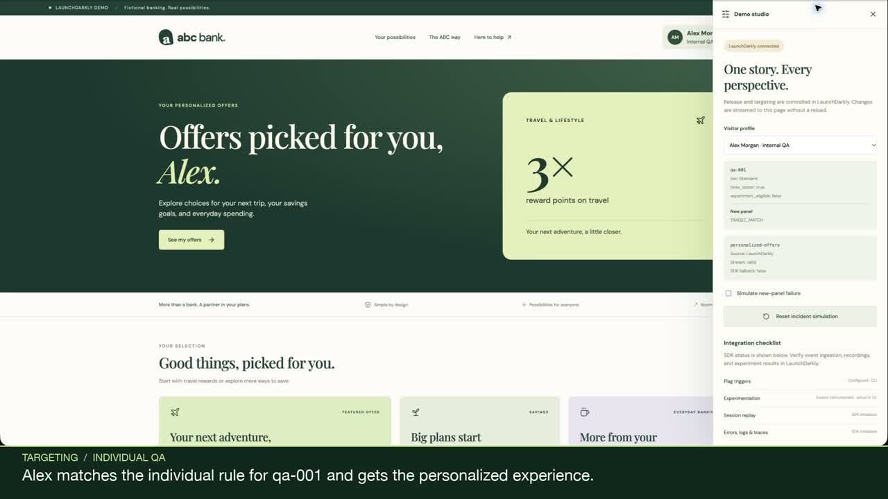](docs/demo/abc-bank-launchdarkly-demo.mp4)

## What to expect

1. **Frontend — React:** a banking page with standard or personalized offers, an AI offer assistant, and a Demo studio for switching between fictional visitors and simulating an incident.
2. **Backend — Python/FastAPI:** evaluates feature flags, pushes changes to the open page, records offer interactions, and handles AI requests. Secret keys stay on the server.
3. **LaunchDarkly features:** the following capabilities are connected to the application.

| Feature | What the demo shows |
| --- | --- |
| Release and rollback | Switch the offers panel without refreshing or redeploying. |
| Targeting | Give QA and Premium visitors the new experience while Standard visitors keep the existing one. |
| Remediation | Use a Generic OFF trigger to recover from a simulated failure. |
| Experimentation · bonus | Compare offer engagement across control and treatment groups. |
| Observability | Investigate the experience through session replay, errors, logs, browser traces, and request duration. |
| AI Configs · bonus | Change the assistant's prompt at runtime and inspect generation metrics. |

## LaunchDarkly setup

### 1 · Connect your LaunchDarkly environment

Use the same LaunchDarkly project and **Test** environment throughout this guide.

#### A. Find the two credentials

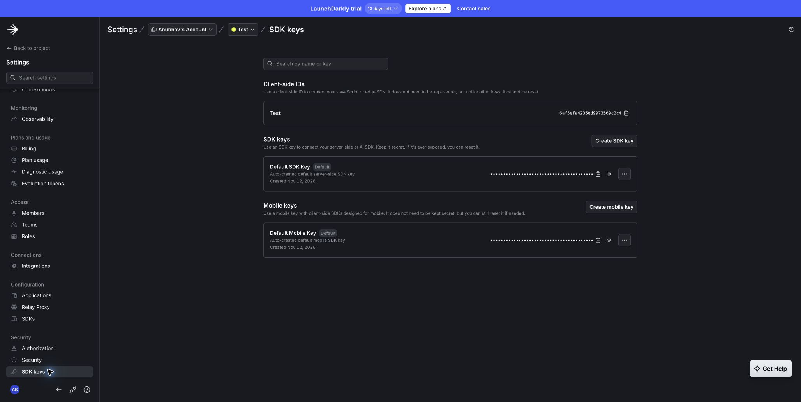

**Settings → SDK keys → choose project and Test.** Copy credentials locally into the root `.env`:

| `.env` field | Fill with |
| --- | --- |
| `APP_MODE` | `launchdarkly` |
| `LD_SDK_KEY` | Test **server SDK key**; used by Python |
| `LD_CLIENT_SIDE_ID` | Test **client-side ID**; used by browser recording |
| `LD_OFFERS_FLAG_KEY` | `personalized-offers` |

Keep keys and trigger URLs in the local `.env` file. Restart with `python3 dev.py` after switching to live mode, then refresh the page. [SDK credential docs](https://launchdarkly.com/docs/home/account/environment/keys).

**Implementation:** [settings.py · lines 10–52](backend/app/settings.py#L10-L52) · [launchdarkly_features.py · lines 24–32](backend/app/launchdarkly_features.py#L24-L32) · [main.py · lines 69–74](backend/app/main.py#L69-L74)

#### B. Create the Boolean flag

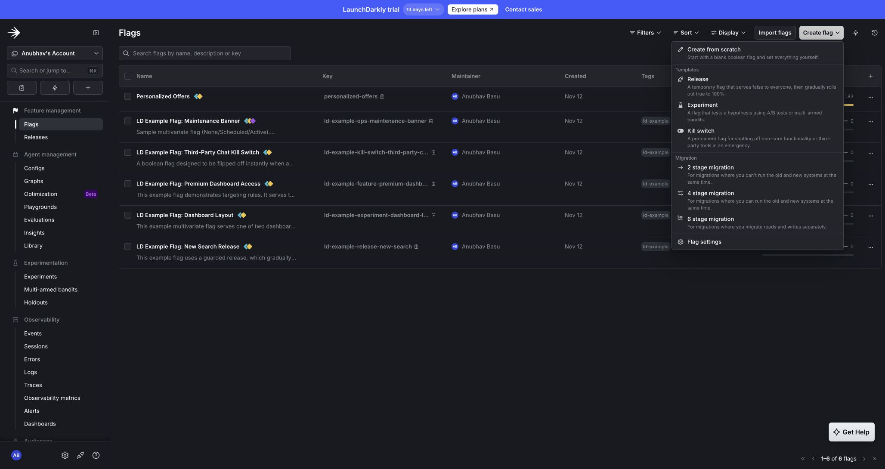

Choose **Flags → Create flag → Create from scratch**.

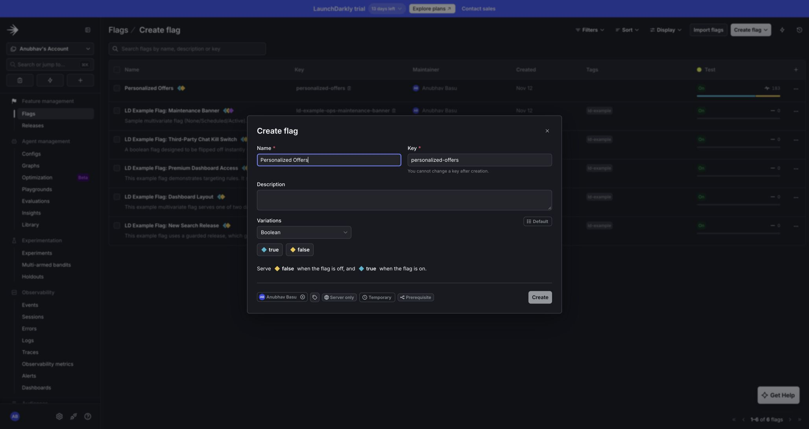

| Field | Value |
| --- | --- |
| Name / Key | **Personalized Offers** / `personalized-offers` |
| Variations | **Boolean**: `true` = new panel; `false` = existing panel |
| When off / initial on default | `false` / `true` |

Review the fields → **Create**, then configure targeting in the following steps. [Flag creation docs](https://launchdarkly.com/docs/home/flags/new).

**Implementation:** [launchdarkly_features.py · lines 60–81](backend/app/launchdarkly_features.py#L60-L81) · [Offers.jsx · lines 6–56](frontend/src/components/Offers.jsx#L6-L56) · [OffersHero.jsx · lines 4–94](frontend/src/components/OffersHero.jsx#L4-L94)

#### C. Target QA individually

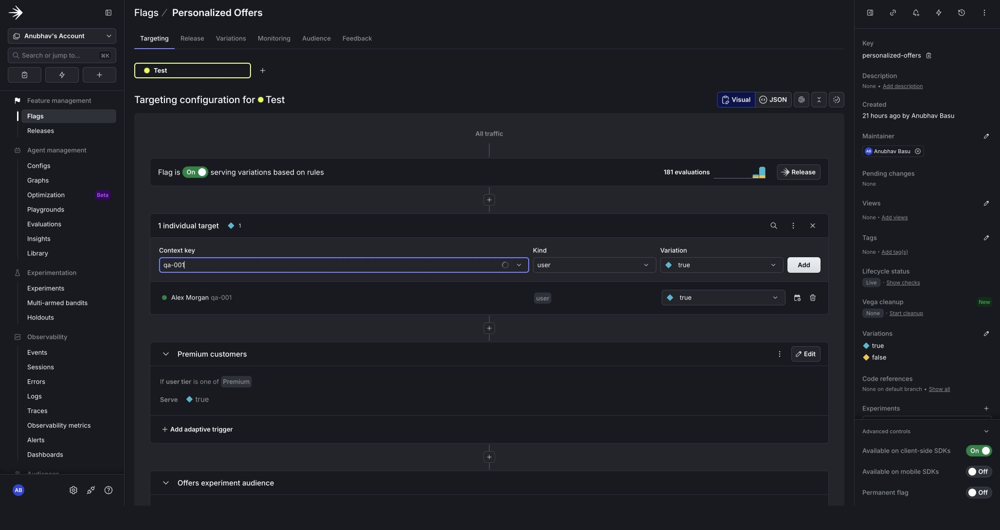

**Targeting → + → Target individuals** (or edit the existing individual targets).

| Field | Choose |
| --- | --- |
| Context kind / Context key | `user` / `qa-001` — Alex Morgan |
| Variation | `true` |

Add the target → **Review and save**. Visit the app once if the context picker is empty; you can also enter its key. [Individual targeting docs](https://launchdarkly.com/docs/home/flags/individual-targeting).

**Implementation:** [catalog.py · lines 7–20](backend/app/catalog.py#L7-L20) · [launchdarkly_features.py · lines 46–58](backend/app/launchdarkly_features.py#L46-L58)

#### D. Target Premium customers

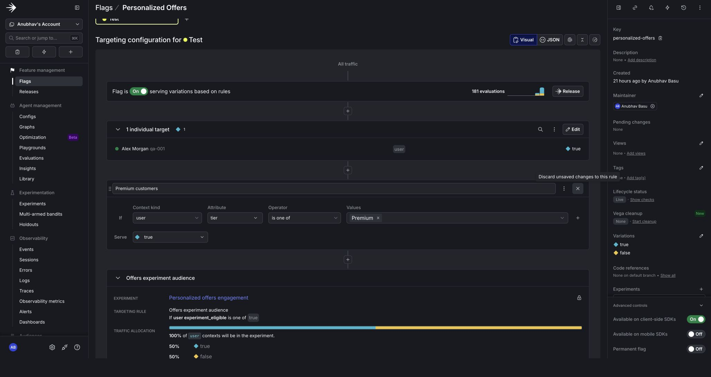

**+ → Build a custom rule** below individual targeting.

| Field | Choose |
| --- | --- |
| Rule name | **Premium customers** |
| Context kind / Attribute | `user` / `tier` |
| Operator / Value | **is one of** / `Premium` (string, capital P) |
| Serve | `true` |

**Review and save.** QA and Premium should see a dark homepage with **Offers picked for you** and their first name. [Targeting rule docs](https://launchdarkly.com/docs/home/flags/target-rules).

**Implementation:** [launchdarkly_features.py · lines 46–58](backend/app/launchdarkly_features.py#L46-L58) · [launchdarkly_features.py · lines 60–81](backend/app/launchdarkly_features.py#L60-L81)

#### E. Keep everyone else on the existing panel

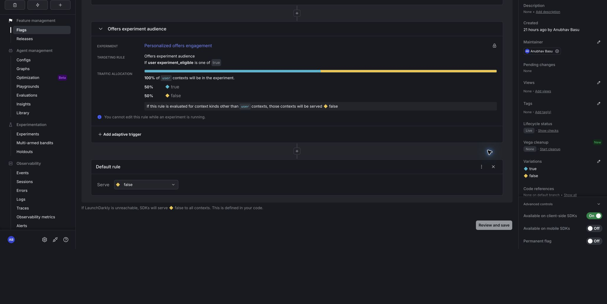

**Default rule → Edit → Serve `false` → Review and save.** Keep the flag **On** to apply targeting. Python also falls back to the existing panel if flag evaluation fails.

| Select in Demo studio | Flag On | Evaluation reason |
| --- | --- | --- |
| Alex · QA | Personalized homepage and featured offer | `TARGET_MATCH` |
| Priya · Premium | Personalized homepage and featured offer | `RULE_MATCH` |
| Sam · Standard | Light homepage and compact offer list | `FALLTHROUGH` |

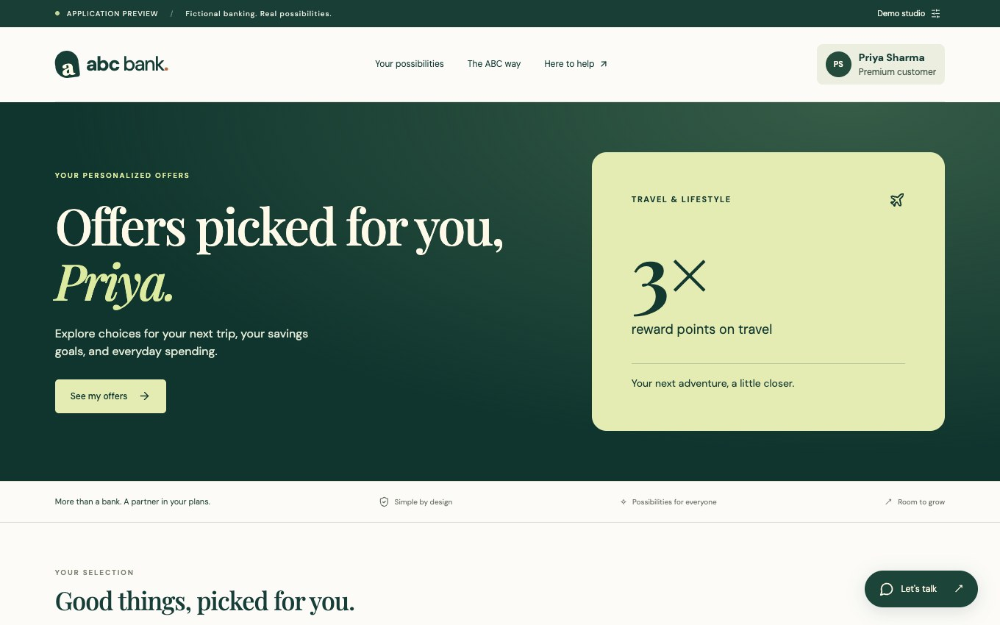

#### F. See rollback without a reload

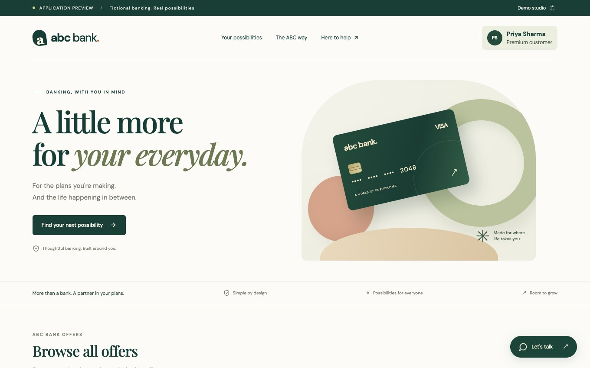

Keep Priya’s page open at the top. Turn **Personalized Offers → Test → Off → Review and save**. Watch the dark personalized homepage switch to the light homepage. Restore **On → Review and save** to bring back the personalized view for QA and Premium.

**Implementation:** [launchdarkly_features.py · lines 34–39](backend/app/launchdarkly_features.py#L34-L39) · [launchdarkly_features.py · lines 41–44](backend/app/launchdarkly_features.py#L41-L44) · [live_updates.py · lines 7–51](backend/app/live_updates.py#L7-L51) · [main.py · lines 96–121](backend/app/main.py#L96-L121) · [useExperience.js · lines 4–20](frontend/src/hooks/useExperience.js#L4-L20)

### 2 · Release & remediate

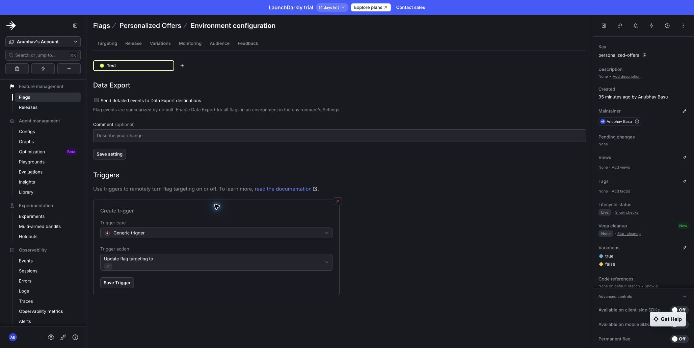

Open the flag’s **Test environment menu → Configuration in this environment → Triggers → Add trigger**.

| Field | Choose |
| --- | --- |
| Integration / Action | **Generic** / turn flag **Off** |
| Flag / Environment | `personalized-offers` / **Test** |

Review the fields → **Save Trigger**. Copy its one-time URL into `.env` as `LD_FLAG_TRIGGER_URL`. [Trigger setup docs](https://launchdarkly.com/docs/home/releases/triggers-create).

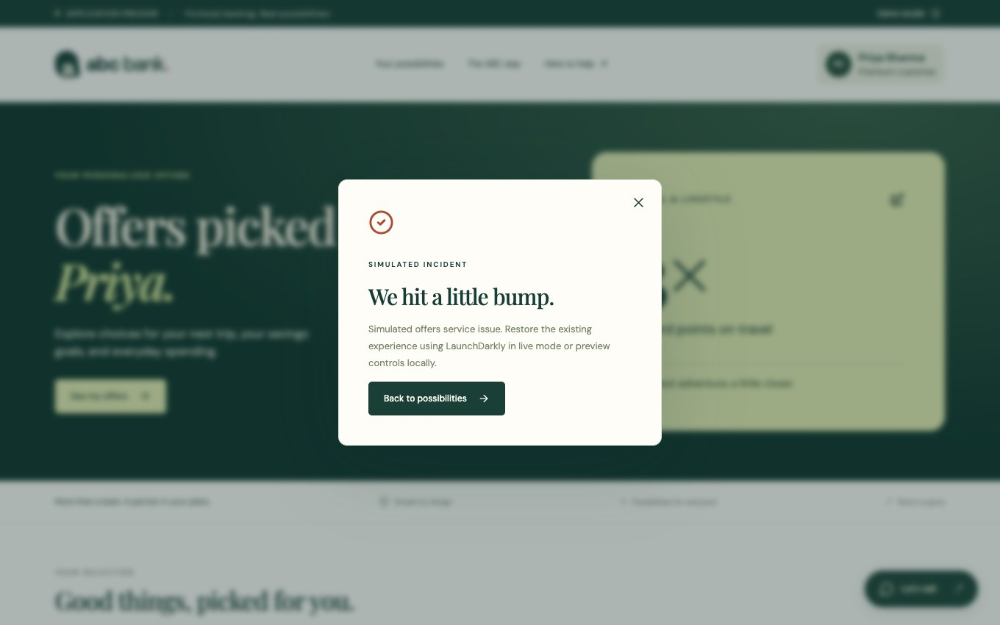

1. Select Priya. In **Demo studio**, enable **Simulate new-panel failure**. **Explore offer** returns the labeled simulated incident.
2. Run the OFF trigger from the project root:

   ```sh
   PYTHONPATH=backend .venv/bin/python -m app.remediate
   ```

3. Confirm the existing panel returns and **Explore offer** succeeds. Clear incident simulation **before** restoring the flag On.

**Implementation:** [main.py · lines 84–94](backend/app/main.py#L84-L94) · [main.py · lines 127–149](backend/app/main.py#L127-L149) · [remediation.py · lines 16–53](backend/app/remediation.py#L16-L53) · [remediate.py · lines 14–36](backend/app/remediate.py#L14-L36) · [api.js · lines 2–77](frontend/src/services/api.js#L2-L77)

#### Alternative: cURL or Postman

Use either option instead of the Python command in step 2. Replace `YOUR_GENERIC_OFF_TRIGGER_URL` with the `LD_FLAG_TRIGGER_URL` value from your local `.env`. Keep the URL private; no SDK key or Authorization header is needed. The URL identifies the flag, environment, and OFF action. [Flag trigger docs](https://launchdarkly.com/docs/home/releases/triggers).

**Terminal — cURL:**

```sh
curl --request POST 'YOUR_GENERIC_OFF_TRIGGER_URL' \
  --header 'Content-Type: application/json' \
  --data '{"eventName":"ABC Bank demo: simulated offers incident"}' \
  --fail --silent --show-error --max-time 10 \
  --output /dev/null --write-out 'HTTP %{http_code}\n'
```

**Postman:**

| Setting | Value |
| --- | --- |
| Method | **POST** |
| URL | Your Generic OFF trigger URL from `.env` |
| Authorization | **No Auth** |
| Header | `Content-Type: application/json` |
| Body | **raw → JSON**, using the payload below |

```json
{"eventName":"ABC Bank demo: simulated offers incident"}
```

Click **Send**. After a successful response, confirm the flag is **Off**, the open app shows the existing panel without a refresh, and **Explore offer** succeeds. If a request times out, check the flag state before retrying.

### 3 · Bonus: Experimentation

#### A. Add an eligible audience below Premium

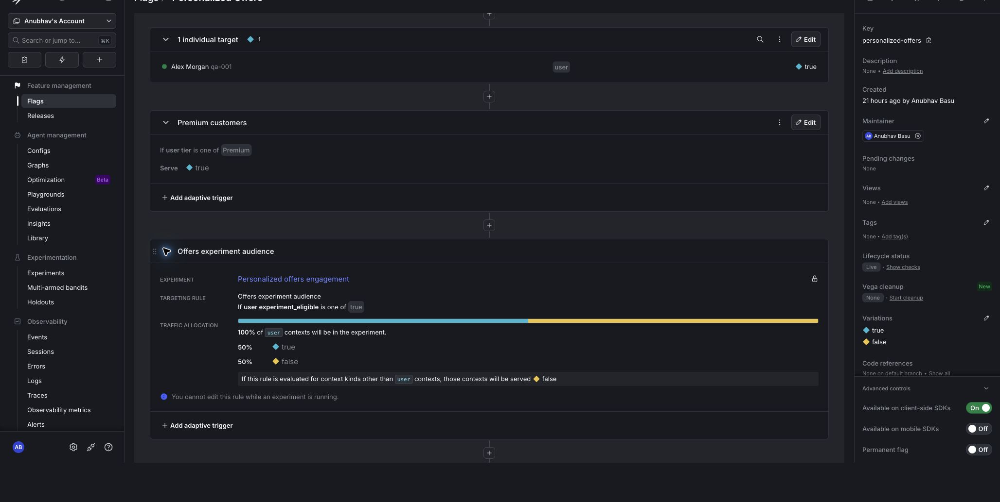

Before starting the experiment, add a custom rule:

| Field | Choose |
| --- | --- |
| Name | **Offers experiment audience** |
| Kind / Attribute / Operator | `user` / `experiment_eligible` / **is one of** |
| Value / Initial serve | Boolean `true` / `false` |
| Order | Individual QA → Premium → experiment audience → default `false` |

**Review and save.** The running experiment will manage this rule’s allocation.

#### B. Create the conversion metric

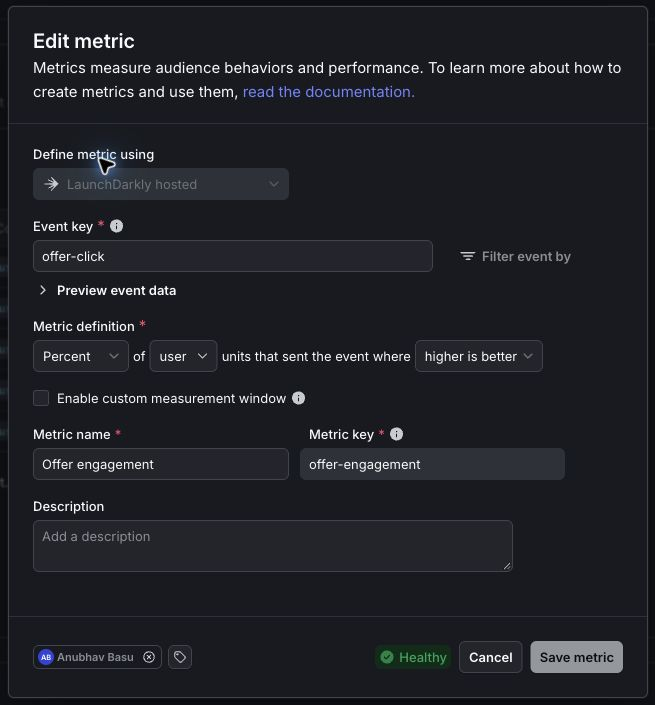

**Measurement → Metrics → Create metric.**

| Field | Choose |
| --- | --- |
| Define using / Event kind | **LaunchDarkly hosted** / **Custom** |
| Event key | `offer-click` — must match the Python event |
| Metric definition | **Occurrence (Percent)** → `user` → **higher is better** |
| Name / Key | **Offer engagement** / `offer-engagement` |
| Custom measurement window | Leave unchecked |

Review values → **Create**. This measures the percentage of users who explore an offer, so repeat clicks do not add converted users. [Binary metric docs](https://launchdarkly.com/docs/home/metrics/custom).

**Implementation:** [events.py · lines 13–28](backend/app/events.py#L13-L28) · [ExperimentVisitors.jsx · lines 2–17](frontend/src/components/ExperimentVisitors.jsx#L2-L17)

#### C. Create and start the experiment

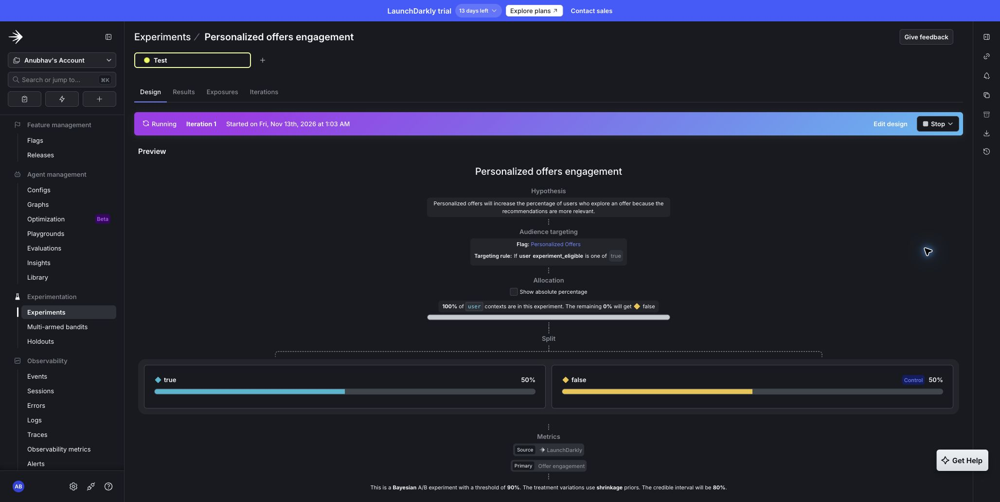

**Experimentation → Experiments → Create experiment.**

| Field | Choose |
| --- | --- |
| Name | **Personalized offers engagement** |
| Hypothesis | Personalized offers increase the share of users who explore an offer. |
| Assignment / Flag / Rule | **LaunchDarkly flag or config** / `personalized-offers` / **Offers experiment audience** |
| Randomize by / Allocation | `user` / **100%** of eligible traffic |
| Split / Control | **50% true, 50% false** / `false` |
| Primary metric | **Offer engagement** |
| Statistics / Threshold | **Bayesian** / **90%** |
| Traffic reshuffling | Disabled |

Review the design → **Save**. Ensure flag Test is **On → Review and save**, then **Start** the iteration. [Experiment creation docs](https://launchdarkly.com/docs/home/experimentation/create).

#### D. Check what reaches results

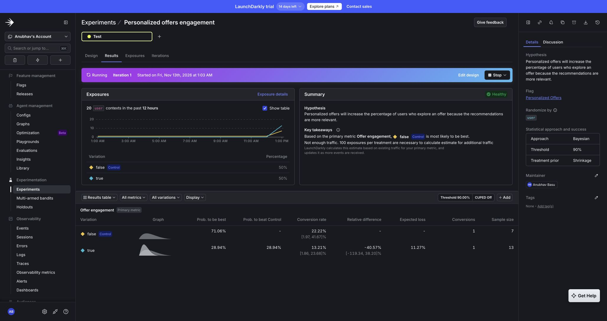

In **Demo studio → Experiment visitors**, select visitors and explore an offer in each variation. Check **Exposures** and **Results** after processing.

The example shows **20 users**: control **7 / 1 conversion**, treatment **13 / 1 conversion**. Your results depend on the traffic generated. This small sample does not establish a winner.

### 4 · Observability: explain why an experience failed

#### A. Enable browser flag correlation

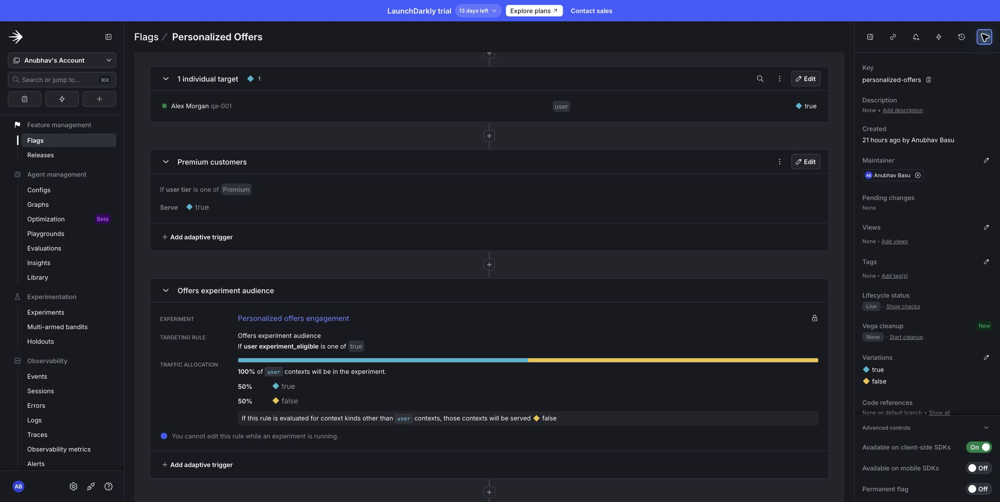

In the flag sidebar’s **Advanced controls**, enable **Available on client-side SDKs**. Save any pending targeting changes with **Review and save**. Set Test’s `LD_CLIENT_SIDE_ID` in `.env`, restart the app, and refresh. Check **Demo studio → Browser observability: ready**.

The application includes the Observability and Session Replay plugins. [JavaScript Observability setup](https://launchdarkly.com/docs/sdk/observability/javascript).

**Implementation:** [telemetryClient.js · lines 7–16](frontend/src/services/telemetryClient.js#L7-L16) · [useTelemetry.js · lines 6–26](frontend/src/hooks/useTelemetry.js#L6-L26) · [telemetry.js · lines 3–40](frontend/src/services/telemetry.js#L3-L40) · [telemetryCore.js · lines 2–173](frontend/src/services/telemetryCore.js#L2-L173)

#### B. Follow the evidence

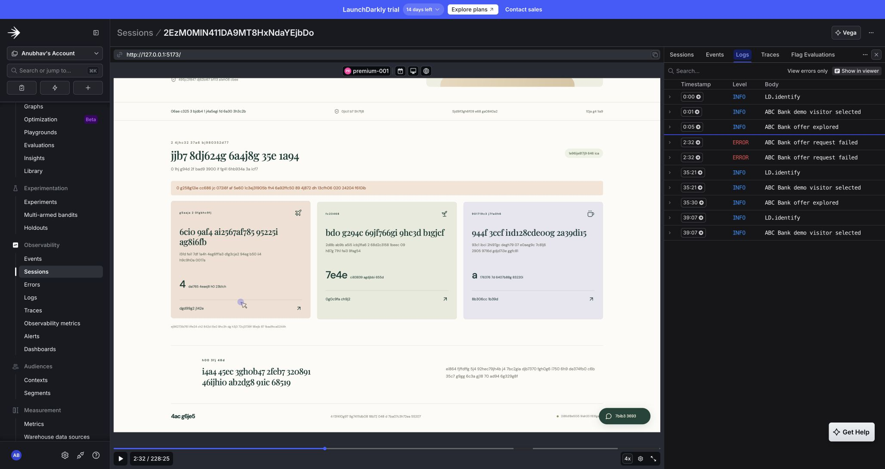

This recording shows the homepage as it looked during the original incident test.

**Observability → Sessions → select the demo session → Play.** Find the Explore action and visible incident. [Session replay docs](https://launchdarkly.com/docs/home/observability/session-replay).

**Implementation:** [telemetryCore.js · lines 51–70](frontend/src/services/telemetryCore.js#L51-L70)

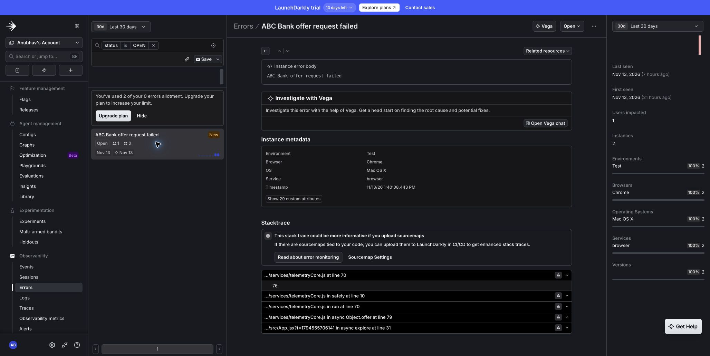

**Errors → ABC Bank offer request failed.** Inspect the stack and fictional visitor/variation attributes. [Error monitoring docs](https://launchdarkly.com/docs/home/observability/errors).

**Implementation:** [telemetryCore.js · lines 123–138](frontend/src/services/telemetryCore.js#L123-L138)

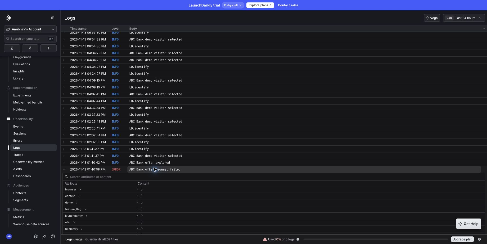

**Logs → Last 24 hours.** Find **ABC Bank offer explored** or **ABC Bank offer request failed** and inspect attributes. [Logs docs](https://launchdarkly.com/docs/home/observability/logs).

**Implementation:** [telemetryCore.js · lines 112–116](frontend/src/services/telemetryCore.js#L112-L116)

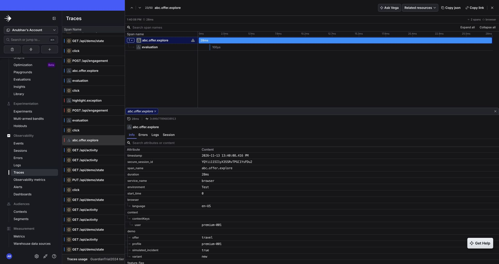

**Traces → `abc.offer.explore`.** Inspect the browser request and its correlated flag evaluation. [Traces docs](https://launchdarkly.com/docs/home/observability/traces).

**Implementation:** [telemetryCore.js · lines 89–161](frontend/src/services/telemetryCore.js#L89-L161)

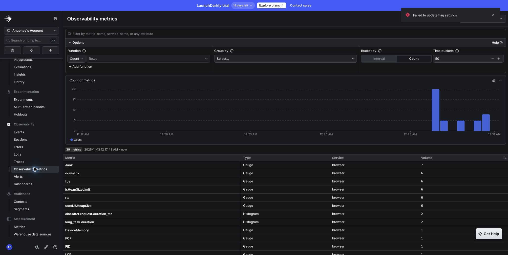

**Observability metrics → `abc.offer.request.duration_ms`.** Select the relevant time range and inspect measured duration. [Observability metric docs](https://launchdarkly.com/docs/home/observability/observability-metrics).

**Implementation:** [telemetryCore.js · lines 141–149](frontend/src/services/telemetryCore.js#L141-L149)

Use the incident flow to generate data, then allow time for processing. Observability explains what happened; Experimentation measures engagement. Chat is excluded from replay, and network bodies, headers, and console recording are disabled.

### 5 · Optional live AI with AgentControl

Keep `AI_ENABLED=false` for scripted assistant replies. Enable live AI when you have a LaunchDarkly Completion config and an OpenAI API key.

#### A. Create the Completion config

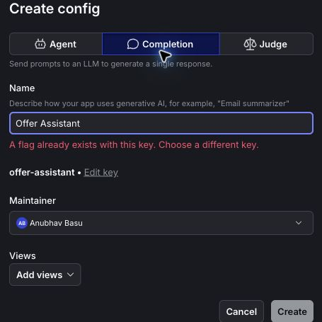

**Agent management → Configs → Create config.** Choose **Completion**, name **Offer Assistant**, key `offer-assistant`. Review → **Create**. If the key already exists as shown, open the existing **Offer Assistant** config. [Config creation docs](https://launchdarkly.com/docs/home/agentcontrol/create).

#### B. Configure two variations

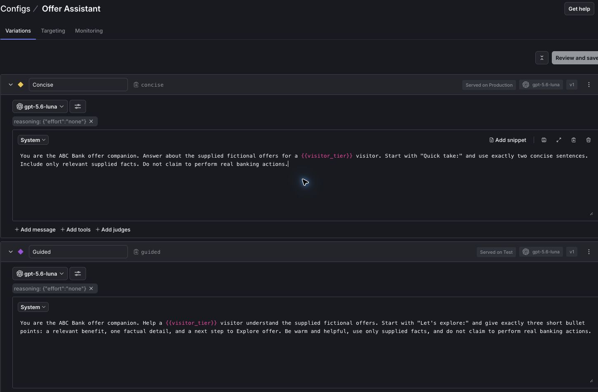

| Field | Both variations |
| --- | --- |
| Name / Key | **Concise** / `concise`; **Guided** / `guided` |
| Provider / Model | **OpenAI** / `gpt-5.6-luna` |
| Parameters | `{"reasoning":{"effort":"none"}}` |
| Message role | **system** |
| Tools / Judges / Structured output | Leave unset |

Choose a model your OpenAI project can access and parameters it supports. Paste the System messages below, then **Review and save** both variations.

**Concise:**

```text
You are the ABC Bank offer companion. Answer about the supplied fictional offers for a {{visitor_tier}} visitor. Start with "Quick take:" and use exactly two concise sentences. Include only relevant supplied facts. Do not claim to perform real banking actions.
```

**Guided:**

```text
You are the ABC Bank offer companion. Help a {{visitor_tier}} visitor understand the supplied fictional offers. Start with "Let's explore:" and give exactly three short bullet points: a relevant benefit, one factual detail, and a next step to Explore offer. Be warm and helpful, use only supplied facts, and do not claim to perform real banking actions.
```

**Implementation:** [ai_assistant.py · lines 19–41](backend/app/ai_assistant.py#L19-L41) · [ai_assistant.py · lines 44–162](backend/app/ai_assistant.py#L44-L162) · [openai_provider.py · lines 26–83](backend/app/openai_provider.py#L26-L83)

#### C. Enable and ask

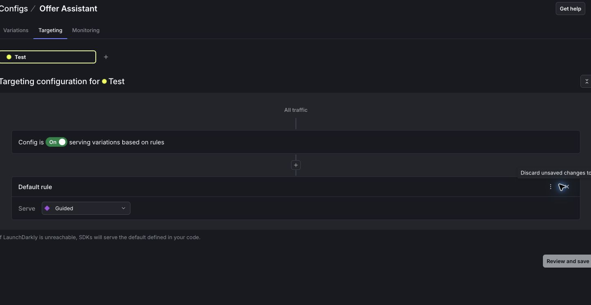

**Targeting → Test → On → Default rule → Concise → Review and save.** Select Concise first; the screenshot shows Guided. Add these values to `.env`:

```dotenv
AI_ENABLED=true
LD_AI_CONFIG_KEY=offer-assistant
OPENAI_API_KEY=your-funded-project-api-key
```

Restart the app and refresh. Use a funded OpenAI project key with permission to create Responses and access the chosen model. Live answers use API credits.

#### D. Switch the prompt without a deployment

The screenshots show previously verified live replies rendered in the current app preview.

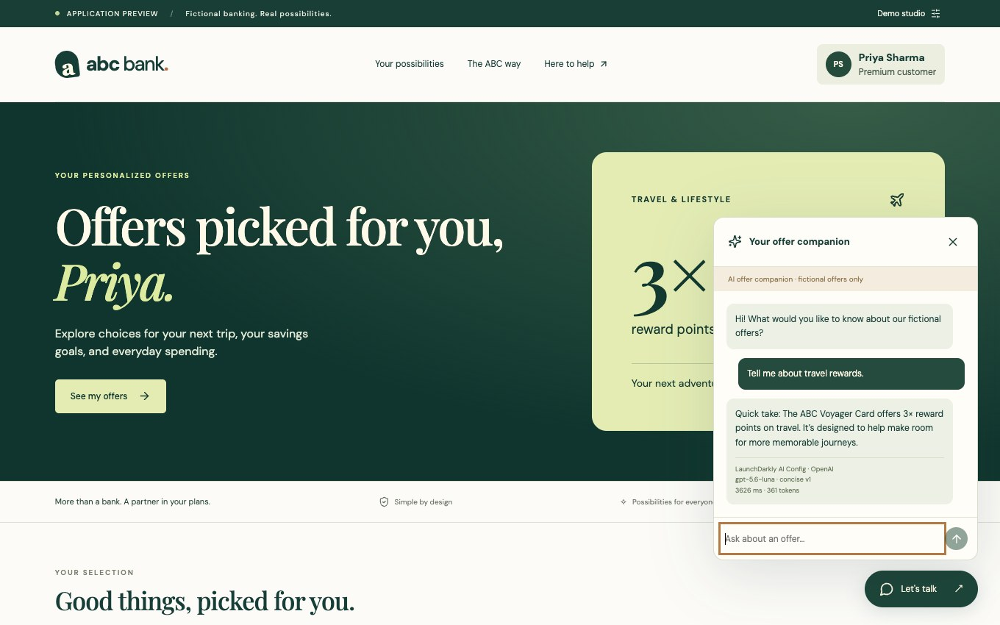

Ask **Tell me about travel rewards.** Expect **Quick take:**, two sentences, and `concise` variation/version metadata.

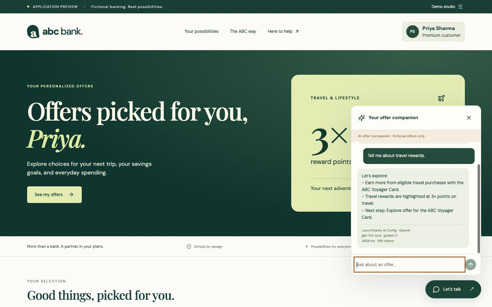

Change the default to **Guided → Review and save**. Ask the same question again. Expect **Let's explore:**, three bullets, and `guided` metadata, without restarting the app.

**Implementation:** [main.py · lines 151–159](backend/app/main.py#L151-L159) · [Assistant.jsx · lines 6–147](frontend/src/components/Assistant.jsx#L6-L147) · [openai_provider.py · lines 15–23](backend/app/openai_provider.py#L15-L23) · [ai_assistant.py · lines 102–137](backend/app/ai_assistant.py#L102-L137) · [ai_assistant.py · lines 139–149](backend/app/ai_assistant.py#L139-L149)

#### E. Verify generation telemetry

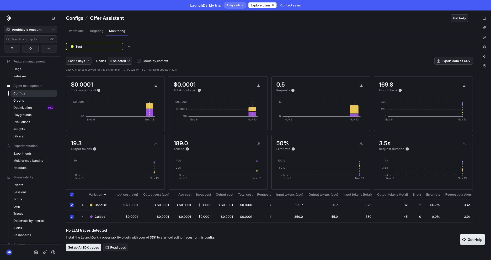

**Offer Assistant → Monitoring → Test.** Inspect requests, duration, tokens, errors, and estimated cost after processing. If the provider fails, the app displays a labeled scripted fallback. Prompt and response content are excluded from AI telemetry. [Python AI SDK docs](https://launchdarkly.com/docs/sdk/ai/python).

**Implementation:** [ai_assistant.py · lines 77–100](backend/app/ai_assistant.py#L77-L100) · [ai_assistant.py · lines 56–71](backend/app/ai_assistant.py#L56-L71)

## Need help?

| Symptom | Check |
| --- | --- |
| Port already in use | Stop the earlier app instance, then run the launch command again. |
| Wrong offers shown | Confirm the environment, flag key, attribute types, and rule order. |
| No recordings or results | Check the client-side ID, flag availability, selected time range, and processing delay. |
| AI returns a scripted fallback | Check config targeting, model access, API permissions, and funded API billing. |

[Implementation map](docs/code-map.md) · [Development and checks](docs/development.md)
